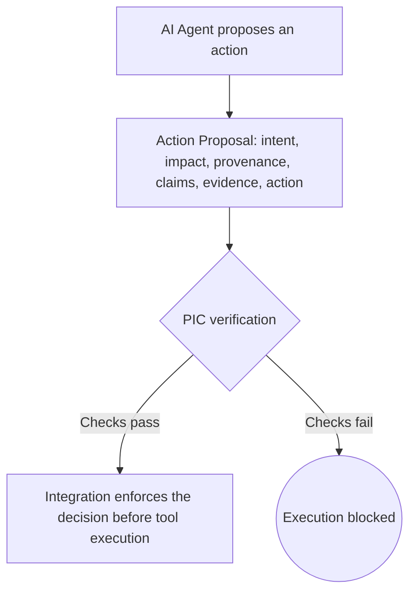

# <p> PIC Standard: Provenance & Intent Contracts</p>

### Require verifiable evidence before your AI agent acts.

**Local-first. Open source. Your policy and trusted keys.**

[](https://pypi.org/project/pic-standard/)
[](https://pypi.org/project/pic-standard/)
[](https://github.com/pic-standard/pic-standard/blob/main/RELEASING.md)
[](https://www.bestpractices.dev/projects/12790)
[](https://github.com/pic-standard/pic-standard/actions/workflows/ci.yml)
[](https://docs.astral.sh/ruff/)
[](https://github.com/pic-standard/pic-standard/blob/main/pyproject.toml)
[](https://github.com/pic-standard/pic-standard/commits/main)
[](https://github.com/pic-standard/pic-standard)
[](https://doi.org/10.5281/zenodo.18725562)
[](https://github.com/pic-standard/pic-standard/blob/main/LICENSE)

Before an agent makes a payment, exports sensitive data, or deletes a resource, it must declare what it intends to do, which sources informed the decision, and what evidence supports its claims.

PIC adds a verification gate before tool execution. It checks the action proposal, verifies supporting evidence against your trusted keys, and enforces the required connection between claims and trusted provenance. Your integration blocks execution when verification fails.

The intent, provenance, claims, and proposed action travel together in a structured contract. Canonical signed attestations bind supporting evidence to the specific action being proposed.

[Try PIC](#quickstart) · [See a signed approval in action](#see-the-contract-in-action) · [Integrations](#integrations) · [Specifications](#specifications-and-conformance) · [Contribute](#contributing)



PIC checks the proposal and supporting evidence. The execution integration must enforce the decision and ensure the tool receives the verified arguments.

## Why PIC?

An agent may have permission to use a payment tool and still act on a forged invoice, an injected instruction, or an unsupported claim that someone approved the transaction.

PIC gives your application a contract for checking the proposed action and its supporting evidence before execution. You decide which tools require PIC and which signing keys to trust. Verification runs in code, without asking a model whether its own decision was justified.

- **Require evidence for high-impact actions.** Money, privacy, and irreversible actions require a claim linked to trusted provenance under PIC's core rule.
- **Reject self-asserted trust.** Incoming provenance labels are sanitized to `untrusted` by default. Accepted signature evidence can establish trust through your configured keyring.
- **Bind evidence to the proposed action.** Canonical attestations bind the tool, arguments, impact, claims, and provenance IDs. They also support intent binding and expiry checks.
- **Check the arguments at the tool boundary.** The Python MCP guard and HTTP bridge compare the submitted live arguments with the verified proposal and reject mismatches.
- **Keep verification under your control.** Run locally, use your own trusted keys, and integrate through Python or the HTTP API. No hosted PIC account or model API key is required for verification.

## The PIC contract

Every Action Proposal brings the decision and the intended tool call into one verifiable structure.

| Field | What it declares |
|---|---|
| `intent` | What the agent intends to do |
| `impact` | The action's risk class |
| `provenance` | The sources declared to have informed the decision |
| `claims` | The assertions supporting the action, with evidence references |
| `evidence` | Artifacts or signatures the verifier can check |
| `action` | The proposed tool and its arguments |

PIC defines seven impact classes: `read`, `write`, `external`, `compute`, `money`, `privacy`, and `irreversible`.

For `money`, `privacy`, and `irreversible`, at least one claim must reference trusted provenance. With strict trust enabled, an agent cannot satisfy that requirement simply by writing `"trust": "trusted"`.

Operator policy maps tools to impact classes and determines where proposals and evidence verification are required. Applications can impose additional requirements, such as a particular approver or a refund-specific argument schema.

## See the contract in action

A merchant approves a **€40 EUR refund on payment `pay_A`**. The agent submits a proposal containing the refund intent, merchant provenance, approval references, signed evidence, and the exact refund action.

PIC verifies the signature and its binding to the proposal. The example's execution wrapper checks the refund workflow's requirements and calls the tool only after those checks pass.

| Case | Result |
|---|---|
| Valid approval for the proposed refund | Allowed; tool called with the verified arguments |
| Required evidence removed | Blocked |
| Forged signature or unknown signing key | Blocked |
| Approval has expired | Blocked |
| Payment, amount, or currency changed after signing | Blocked |
| Approval references changed after signing | Blocked |
| Signature is valid, but the proposal fails the refund workflow's requirements | Blocked by the workflow checks |
| Separate execution arguments differ from the verified proposal | Blocked by the execution wrapper |

The example includes **22 verification and dispatch cases**, with tool-call counts and checks on the actual arguments received. Two deliberately broken wrappers verify that the suite detects premature execution and substituted arguments.

It uses a harmless recording tool; no money moves. The example documents which checks belong to PIC and which belong to the refund workflow.

**[Run the signed-refund example →](examples/refund-approval/README.md)**

## Quickstart

### Install the Python verifier

Python 3.10 or later:

```bash
python -m pip install "pic-standard[crypto]"
```

The `crypto` extra enables Ed25519 signature verification. Install `pic-standard` without extras when you do not need signature verification.

### Verify valid and tampered evidence

The sample files live in the repository. From a checkout, install the source and run the fixtures:

```bash
git clone https://github.com/pic-standard/pic-standard.git
cd pic-standard
python -m pip install -e ".[crypto]"
```

On macOS or Linux:

```bash
export PIC_KEYS_PATH="$PWD/pic_keys.example.json"
pic-cli verify examples/financial_sig_ok.json --verify-evidence --json
pic-cli verify examples/failing/financial_sig_bad.json --verify-evidence --json
```

On PowerShell:

```powershell
$env:PIC_KEYS_PATH = "$PWD/pic_keys.example.json"
pic-cli verify examples/financial_sig_ok.json --verify-evidence --json
pic-cli verify examples/failing/financial_sig_bad.json --verify-evidence --json
```

The valid fixture returns `"ok": true`; the tampered fixture returns `"ok": false` with `PIC_EVIDENCE_FAILED`. These commands verify evidence without executing a tool. The bundled demo keys expire on 1 January 2027.

These small fixtures demonstrate legacy signature verification. For a complete approval bound to an action, follow the [signed-refund example](examples/refund-approval/README.md), which has its own pinned installation and execution instructions.

Next: [integration guide](docs/for-agents.md) · [signature walkthrough](examples/walkthroughs/signature-evidence.md) · [examples index](examples/README.md)

## Integrations

| Environment | Integration | Start here |
|---|---|---|
| Python MCP server | Synchronous and asynchronous tool guards, evidence verification, live-argument binding, decision logging, and an optional pre-execution hook | [MCP guide](docs/mcp-integration.md) |
| LangGraph | `PICToolNode` verifies proposals and tool names before invoking tools | [Integration guide](docs/for-agents.md) |
| OpenClaw | Pre-tool-call plugin using the Python HTTP bridge; blocks when verification fails or the bridge is unavailable | [OpenClaw guide](docs/openclaw-integration.md) |
| Cordum | External Pack composing PIC verification as a workflow gate | [Cordum guide](docs/cordum-integration.md) |
| Other languages and services | HTTP verification API with an OpenAPI contract | [OpenAPI](openapi/pic-bridge.v1.yaml) · [Deployment](docs/deploy-docker.md) |

Optional Python extras:

```bash
python -m pip install "pic-standard[mcp,crypto]"
python -m pip install "pic-standard[langgraph,crypto]"
```

Configure the tools that require PIC, enable evidence verification, and supply trusted keys. The [integration guide](docs/for-agents.md) covers the complete execution-boundary setup.

**Argument binding in v0.9.1:** the MCP guard and HTTP bridge check live arguments against the verified proposal. The LangGraph node does not yet perform that comparison; applications using it must enforce it before dispatch.

The HTTP bridge verifies a submitted call; its caller controls execution. A successful HTTP response is not necessarily an allow decision: inspect `allowed`.

## Evidence and trusted keys

PIC supports two evidence types:

| Evidence | What verification establishes |
|---|---|
| SHA-256 hash | The referenced file's bytes match the expected digest. Hash evidence alone does not establish authority or upgrade trust. |
| Ed25519 signature | The signature verifies under an accepted key. Canonical signing additionally checks the attestation's binding to the proposal. |

Canonical `PIC-ATT/1.0` attestations bind the tool, impact, ordered provenance IDs, arguments digest, and claims digest. An intent digest and expiry are checked when present. A workflow can require those fields, as the refund example does.

Trusted keys are configured outside agent-controlled proposals. PIC supports key expiry, revoked-key lists, and a `KeyResolver` interface for operator-managed trust sources.

```bash
pic-cli keys
pic-cli keys --write-example
```

File evidence is restricted to a configured evidence directory and bounded by size limits. Proposal and evidence limits, canonicalization checks, and structured error codes support predictable rejection of malformed input.

[Evidence guide](docs/evidence.md) · [Keyring guide](docs/keyring.md) · [Error reference](docs/ERRORS.md)

## Security model

PIC operates between an agent's proposal and tool execution. Identity systems, task-scoped permissions, and execution logs can work alongside PIC.

Its verification checks structured declarations and evidence. It does not infer the model's private reasoning, prove that every influencing source was disclosed, or decide whether a signer made a sound business decision.

Your application owns the trusted keys, tool policy, and execution path. It must prevent bypass, enforce any workflow-specific approval requirements, and execute the checked arguments. Approval consumption, replay prevention, provider idempotency, and execution reconciliation belong to the surrounding workflow.

An allow decision records successful verification; it does not establish that the tool executed or that the intended effect occurred.

For new signed-approval workflows, use canonical attestations with the required binding and validity fields. Legacy payload signatures remain supported in v0.9.1 for compatibility and do not provide the same action binding.

Report vulnerabilities privately through [GitHub Security Advisories](https://github.com/pic-standard/pic-standard/security/advisories/new). See [SECURITY.md](SECURITY.md).

## Specifications and conformance

PIC is an open protocol with a Python reference implementation and a separate [TypeScript implementation](https://github.com/pic-standard/pic-standard-ts).

The shared corpus contains **91 conformance vectors** in v0.9.1:

| Mode | Vectors |
|---|---:|
| Canonicalization | 15 |
| Core | 10 |
| Trust sanitization | 24 |
| Evidence | 42 |

The Python verifier covers all four modes. TypeScript implements canonicalization, core, and trust sanitization; evidence-mode parity remains a completion item. Advisory differential CI compares the implementations' results for their shared modes.

From an installed repository checkout:

```bash
python -m conformance.run
python -m conformance.run --json
```

Specification entry points:

- [Specification status](docs/spec-status.md): implemented versions, draft status, and conformance profiles.
- [Core verifier semantics](docs/spec-core.md): proposals, trust, impacts, and verifier outcomes.
- [Evidence semantics](docs/spec-evidence.md): hashes, signatures, trust upgrades, and canonical attestation verification.
- [Canonical JSON](docs/canonicalization.md): the byte-level serialization contract.
- [Attestation object](docs/attestation-object-draft.md): the signed action representation.
- [RFC-0001](docs/RFC-0001-pic-standard.md): the original defensive publication and protocol baseline.
- [Vocabulary](docs/vocabulary.md): shared terminology.

Core, Evidence, and Attestation specifications remain drafts ahead of the v1.0 freeze. `PIC/1.0` is the protocol identifier; the current Python package is v0.9.1.

## Releases and roadmap

**v0.9.1** adds MCP/HTTP live-argument binding, an optional MCP pre-execution hook, and structured CLI verification output. See the [changelog](CHANGELOG.md).

The v1.0 work focuses on:

- Completing Python/TypeScript conformance across all modes, including evidence.
- Finalizing Core, Evidence, and Attestation specifications.
- Making strict trust and canonical signing the conformant modes, with legacy behavior clearly separated.
- Resolving remaining semantic ambiguities before freezing the contract.

See the [full roadmap](ROADMAP.md) and [release process](RELEASING.md).

## Contributing

External contributors have already landed conformance vectors, CLI JSON output, Windows CI, and documentation. Contributions from security researchers, framework authors, and protocol implementers are welcome.

- **New to PIC?** Start with the [good-first issues](https://github.com/pic-standard/pic-standard/issues?q=is%3Aissue+is%3Aopen+label%3A%22good+first+issue%22) and [contribution guide](CONTRIBUTING.md).
- **Building an implementation or integration?** Join the [call for contributors](https://github.com/pic-standard/pic-standard/discussions/117). TypeScript evidence mode and Go/Rust implementations are useful tracks.
- **Testing the security model?** Try the signed-refund cases, add a [conformance vector](conformance/adding-a-vector.md), or report a vulnerability privately.

Please include the version, configuration, expected outcome, and a minimal reproduction with technical reports.

## Project information

- **License:** [Apache-2.0](LICENSE). The external Cordum Pack has its own license.
- **Governance:** [GOVERNANCE.md](GOVERNANCE.md) · [Maintainers](MAINTAINERS.md) · [Code of conduct](CODE_OF_CONDUCT.md).
- **Independent review:** [Provenance notes](docs/independent-reviews/README.md) describe PIC-maintained regressions arising from independent evaluation of earlier releases.
- **Foundation-track discussion:** [AAIF project-proposal review](https://github.com/aaif/project-proposals/issues/16#issuecomment-4455960990).
- **Citation:** [CITATION.cff](CITATION.cff) · [Zenodo DOI](https://doi.org/10.5281/zenodo.18725562).

Created and maintained by [Fabio Marcello Salvadori](https://www.linkedin.com/in/fmsalvadori/), with the [PIC Standard community](https://github.com/pic-standard).

If PIC is useful to your work, a GitHub star helps others find it. Questions and ideas are welcome in [Issues](https://github.com/pic-standard/pic-standard/issues) and [Discussions](https://github.com/pic-standard/pic-standard/discussions).
